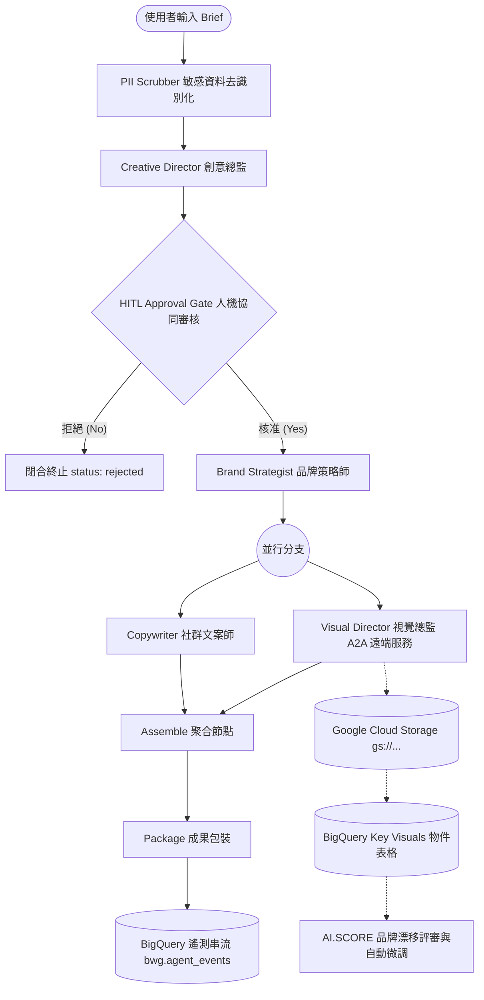

# BuildWithGemini Chapter 5 專案技術文件與架構彙整

本專案為 **BuildWithGemini（Chapter 5）** 代理人導向提案生成系統（Pitch Generator System）。系統採用多代理人協同編排架構，整合 Google Gemini Enterprise Agent Platform、Agent-to-Agent (A2A) 通訊協定、BigQuery 遙測串流與品牌漂移審查、多層安全閘門（PreToolUse 與 PII Scrubber）、人機協同關卡（HITL），以及權杖經濟學（Tokenomics）最佳化機制。

---

## 目錄
1. [系統整體架構與工作流程](#1-系統整體架構與工作流程)
2. [專案運用之各項資源與技能 (Skills)](#2-專案運用之各項資源與技能-skills)
3. [Agentic Workflow 核心優勢與設計目的](#3-agentic-workflow-核心優勢與設計目的)
4. [核心技能原始定義 (Skill MD)](#4-核心技能原始定義-skill-md)
5. [安全防護與治理機制](#5-安全防護與治理機制)
6. [權杖經濟學 (Tokenomics) 實作與基準測試](#6-權杖經濟學-tokenomics-實作與基準測試)

---

## 1. 系統整體架構與工作流程

系統工作流程建立於 ADK (Agent Development Kit) 圖形拓撲上，將單一複雜的行銷提案任務拆解為專職代理人管線：



### 代理人分工表
| 代理人角色 | 執行方式 | 責任範圍與輸出 |
| :--- | :--- | :--- |
| **Creative Director** | 本地 LLM (`gemini-3.8-flash`) | 發想核心概念標語（Concept Line）與行銷策略論述。 |
| **Brand Strategist** | 本地 LLM (`gemini-3.8-flash`) | 定義品牌定位、目標受眾與溝通語調。 |
| **Copywriter** | 本地 LLM (`gemini-3.8-flash`) | 嚴格生成 25 字以內的社群媒體貼文與行動呼籲（CTA）。 |
| **Visual Director** | 遠端 A2A 微服務 (`SERVICE_ROLE=visual-director`) | 載入品牌指導規範（`brand-guidelines`），輸出藝術指導提示並透過 Imagen 生成 Key Visual 圖片存於 GCS。 |

---

## 2. 專案運用之各項資源與技能 (Skills)

### 2.1 自定義技能 (Custom Skills)
- **`start-frontend`** (`.agents/skills/start-frontend/`): 管理本機伺服器連接埠生命週期，以背景守護程式（Daemon）啟動主應用程式（Port 8080）與 A2A 視覺服務（Port 8801）。
- **`lab-helper`** (`.agents/skills/lab-helper/`): 診斷工作區代碼漂移，提供 3-Tier 漸進式提示（概念 $\rightarrow$ 檔案與符號 $\rightarrow$ 實作代碼）及外科手術式修復。
- **`brand-guidelines`** (`pitch_generator/skills/brand-guidelines/`): 視覺美學領域技能，定義色盤、光影、構圖與嚴格禁制詞。

### 2.2 雲端與資料基礎架構
- **Google Cloud Run**: 部署無伺服器微服務容器（`pitch-generator` 與 `visual-director`）。
- **Google Cloud Storage (GCS)**: 保存生成之主視覺 PNG 圖檔。
- **Google BigQuery**:
  - `bwg.agent_events`: 即時寫入每次執行之 Session、延遲、Token 與執行節點追蹤。
  - `bwg.key_visuals`: 使用 `OBJ.MAKE_REF` 與 Cloud Resource 連線映射 GCS 物件。
  - `bwg.brand_review`: 透過 `AI.SCORE` 實施品牌符合度評分。

---

## 3. Agentic Workflow 核心優勢與設計目的

1. **關注點分離（Separation of Concerns）**：避免單一巨大提示詞產生幻覺；各代理人各司其職，提升輸出可控度與可靠度。
2. **閉環自我修復（Closed-Loop Self-Healing）**：以評分模型（`AI.SCORE`）自動偵測提示詞漂移（$< 7.0$），並由 Python 自動剔除霓虹、浮水印等禁制詞後重試，直到評分符合規範。
3. **成本與權杖可控（Predictable Tokenomics）**：藉由記憶壓縮、視窗截斷與靜態提示詞快取，大幅縮減多輪對話 Context 成本達 70% 以上。
4. **安全防護優先（Security-First Design）**：落實「不信任任何輸入」原則，包含 PII 前置遮蔽、工具呼叫白名單校驗及審核失敗立即斷開機制。

---

## 4. 核心技能原始定義 (Skill MD)

### 4.1 品牌指引技能 (`brand-guidelines`)
```markdown
---
name: brand-guidelines
description: Encapsulates house visual style rules and brand identity standards. Use when directing visual assets, setting art direction, or generating key visuals.
---

# House Brand Visual Guidelines

## Palette
- Primary: Deep indigo, warm amber, slate, terracotta.
- Accents: Subtle earth tones and natural textures.

## Light
- Warm raking golden-hour light with long soft shadows.
- Low-angle directional sunlight creating cinematic depth and natural rim lighting.

## Composition
- Off-center hero subject placed along the rule of thirds.
- Generous negative space and intentional breathing room.
- Shallow depth of field with soft focal falloff and subtle background blur.

## Subject
- One realistic photographic subject.
- Authentic, handcrafted materials and natural textures (linen, wood, stone, ceramic).
- Believable, candid posture and natural expression.

## Never
- No neon or fluorescent colors (especially fluorescent cyan or magenta).
- No watermarks, stock photo tags, text overlays, or logos.
- No harsh flat overhead ring light or artificial flash glare.
- No 3D renders, CGI look, plastic skin textures, or cartoon styling.
```

### 4.2 本地服務啟動技能 (`start-frontend`)
```markdown
---
name: start-frontend
description: Manages local server ports and starts the Pitch Generator web server (port 8080) and optional standalone Visual Director A2A service (port 8801) as background daemon processes.
---

# Pitch Generator Start Frontend Skill

Enforces safe server lifecycle on ports 8080 and 8801:
1. Check ports availability.
2. Clean lingering processes.
3. Launch FastAPI server as a background daemon process.
4. Verify /healthz endpoint.
```

---

## 5. 安全防護與治理機制

### 5.1 敏感資料去識別化 (PII Scrubber)
- **實作位址**：`pitch_generator/app_utils/services.py` 之 `PIIScrubber` 與 `ScrubResult`。
- **支援正規化規則**：
  - API Keys / Bearer Token -> `[REDACTED_SECRET]`
  - Credit Cards -> `[REDACTED_CC]`
  - Social Security Numbers -> `[REDACTED_SSN]`
  - Email Addresses -> `[REDACTED_EMAIL]`
  - Phone Numbers -> `[REDACTED_PHONE]`
- **特性**：採用 Deep Copy 保障調用端傳入資料之不可變性（Immutability），且精準保留標準 ISO 日期（`2026-10-15`）與業務指標（`350 lumen`, `45%`）。

### 5.2 工具呼叫前置攔截鉤子 (PreToolUse Hook)
- **白名單政策**：僅允許 `load_skill` 與 `generate_key_visual`。
- **過濾機制**：攔截未授權工具、路徑遍歷語法（`..` 或開頭 `/`）、覆蓋參數（如 `bypass_safety`）、超長字串（$>4096$ chars）及提示詞注入語句（`ignore previous instructions`）。
- **審計紀錄**：每一次工具呼叫檢查皆寫入 `audit_log`。

### 5.3 人機協同審核閘門 (HITL Approval Gate)
- **工作節點**：`approve_concept` (`rerun_on_resume=False`) 與 `user_approval` (`rerun_on_resume=True`)。
- **決策閉合**：
  - `approved is None` -> 觸發暫停（`status="input_required"`），下游代理人呼叫次數為 0。
  - `approved is False` -> 拒絕終止（`status="rejected"`），下游調用數為 0。
  - `approved is True` -> 放行後續 `copywriter` 與 `visual_director` 節點。

---

## 6. 權杖經濟學 (Tokenomics) 實作與基準測試

### 6.1 模組能力
1. **確定性 Token 估算**：`max(1, len(text.strip()) // 4)`。
2. **記憶壓縮 (`compress_memory`)**：最近 2 輪對話逐字保留，其餘自動歸納為 System Summary。
3. **滑動視窗截斷 (`prune_history`)**：在設定的 `max_turns` 與 `max_tokens` 預算內截斷；單一超長訊息自動縮減並標註 `truncated=True`。
4. **SHA-256 靜態提示詞快取 (`PromptCacheManager`)**：對品牌指導規範等長文字計算 64 碼 Hex Hash 並配置 TTL 快取。
5. **模型階層路由器 (`select_model_strategy`)**：支援 `flash`、`pro`、`low`、`high` 與 `local` 5 種模型策略。

### 6.2 10 輪對話實測基準數據 (Flying skateboards for cats)
- **原始對話上下文**：10 輪對話，共 **257 Tokens**。
- **記憶壓縮後**：濃縮為 3 輪（1 個摘要 + 2 輪最新），降低至 **230 Tokens**（節省 10.5%）。
- **滑動視窗截斷後**：進一步過濾為 2 輪，降至 **55 Tokens**（節省 **78.6%**）。
- **品牌指引快取表現**：
  - 第一次請求（Pass 1 - Cache Miss）：`saved_tokens = 0`。
  - 第二次請求（Pass 2 - Cache Hit）：命中快取，直接省下 **293 Tokens**。
- **端到端總節省量**：**495 Tokens**。
